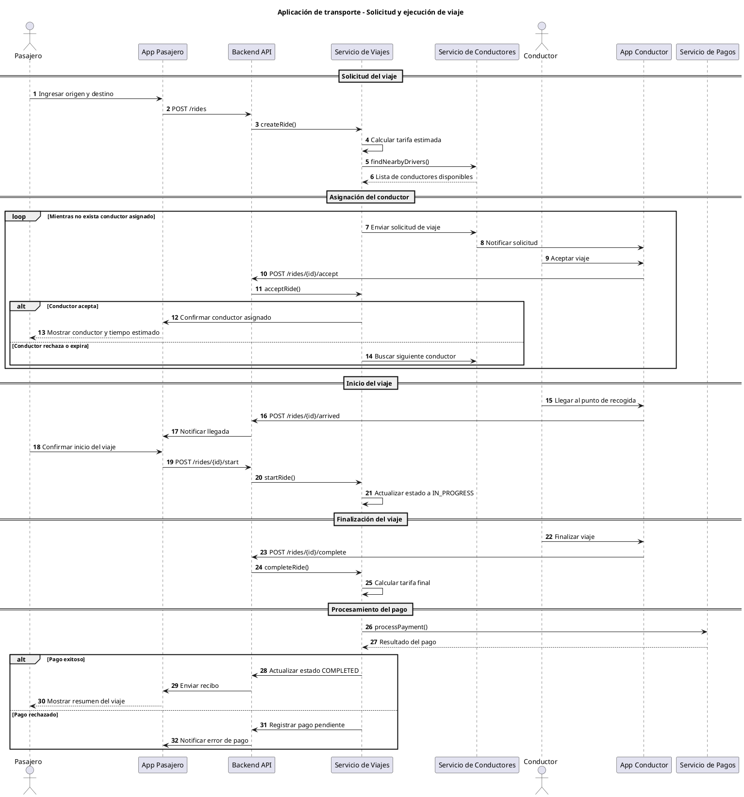
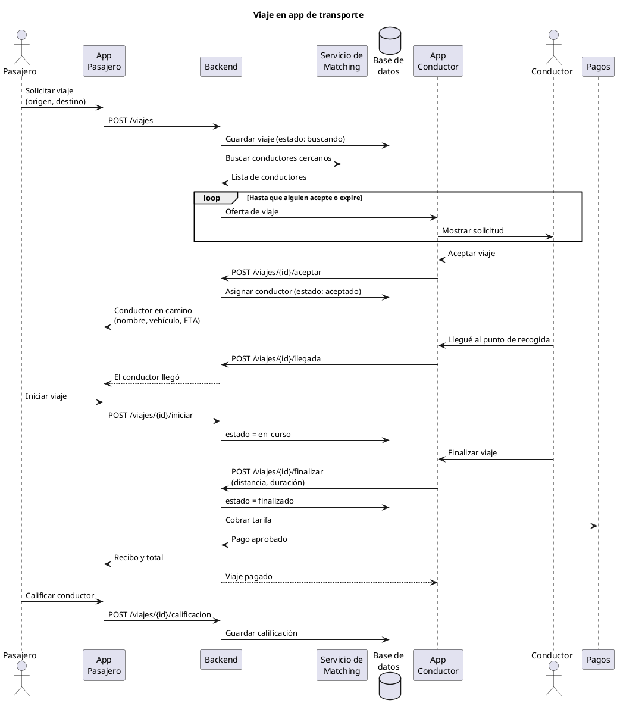
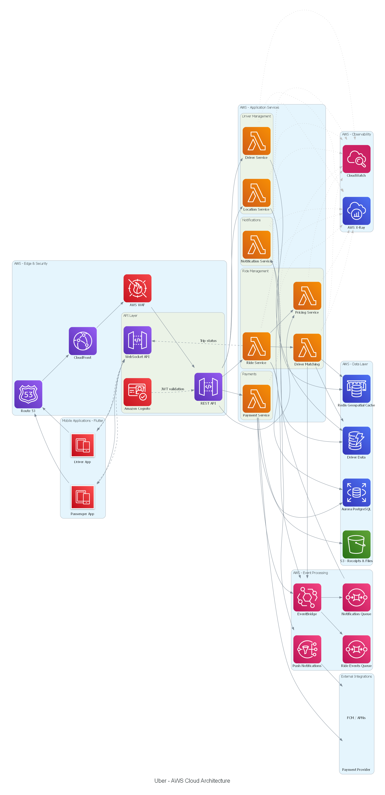
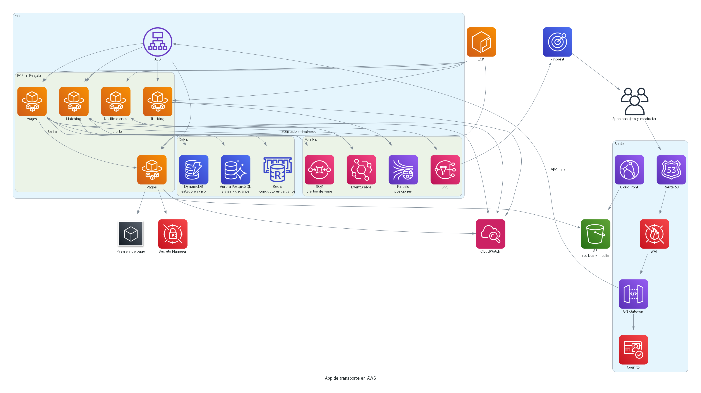

# ACTIVIDAD 1 - Construyendo Diagramas con GenAI

## Prompt #1

> Dame un ejemplo de un diagrama de secuencia en PlantUML de una app de transporte similar a Uber

## Respuesta CHATGPT

Te comparto un ejemplo de un diagrama de secuencia UML en PlantUML para una aplicación de transporte similar a Uber.

Vamos a representar el flujo principal: un usuario solicita un viaje, el sistema busca un conductor, el conductor acepta y se inicia el viaje hasta finalizarlo y realizar el pago.

### Código PlantUML

## Que representa cada participante

| Participante | Responsabilidad |
| --- | --- |
| Pasajero | Solicita y realiza el viaje. |
| App Pasajero | Interfaz para solicitar y monitorear el viaje. |
| Backend API | Punto de entrada de las solicitudes. |
| Servicio de Viajes | Orquesta el ciclo de vida del viaje. |
| Servicio de Conductores | Busca conductores cercanos y disponibles. |
| Conductor | Acepta y ejecuta el servicio. |
| App Conductor | Recibe solicitudes y reporta estados. |
| Servicio de Pagos | Procesa el cobro del viaje. |

## Respuesta Claude

Un flujo típico de una app de transporte (pasajero pide viaje, se asigna conductor, se completa el trayecto y se cobra) se puede expresar así en PlantUML:

### Código PlantUML

Participantes: el pasajero, su app, el backend, el matching, la base de datos, la app del conductor y el servicio de pagos. El diagrama cubre solicitud, aceptación, recogida, trayecto, cobro y calificación.

> Para verlo, pega el bloque en plantuml.com o en una extensión de PlantUML del editor.

### Diagrama UML

## Comparación

Ante el mismo encargo —modelar en un diagrama de secuencia el flujo de una aplicación de transporte—, las dos respuestas difieren en alcance, en coherencia entre el artefacto visual y el código, y en la forma de representar el ciclo de vida del viaje.

El diagrama generado por ChatGPT se concentra en la creación de la solicitud y en el emparejamiento con un conductor cercano. El viaje pasa de `created` a `in_progress` y la aplicación del pasajero recibe la información del conductor, pero la figura no explicita el inicio del trayecto, su finalización, el cobro ni la calificación. Desde la perspectiva del proceso de negocio, eso deja fuera buena parte de la cadena de valor: el diagrama describe cómo se asigna un recurso, no cómo se presta y se cierra el servicio. El código PlantUML de esa misma respuesta es más amplio e incluye solicitud, asignación, inicio, finalización y pago, con alternativas para el rechazo del conductor y para el fallo del cobro. Esa distancia entre la figura y el código es relevante: un modelo de proceso no es confiable si la representación que se muestra no corresponde a la especificación que se entrega.

Claude, en cambio, produce un único flujo coherente entre el código y el diagrama. Recorre la solicitud, la búsqueda de conductores, la aceptación, la llegada al punto de recogida, el inicio del viaje, su cierre, el cobro y la calificación. Cada transición queda asociada a un estado persistido (`buscando`, `aceptado`, `en_curso`, `finalizado`), de modo que el diagrama no solo muestra mensajes entre componentes, sino el avance del caso de negocio. También separa con más claridad las responsabilidades: la aplicación del pasajero, el backend, el servicio de matching, la base de datos, la aplicación del conductor y el servicio de pagos.

La comparación no se reduce a decir que un diagrama tiene más flechas. ChatGPT modela mejor las excepciones dentro del código: el bucle de asignación contempla el rechazo o la expiración de la oferta, y el pago distingue el caso exitoso del rechazado. Claude cubre el camino feliz de punta a punta, incluida la calificación, pero el pago se representa solo como aprobado y la salida del bucle de ofertas queda implícita. Para un diseño operable haría falta completar esas alternativas.

En síntesis, la figura de ChatGPT subespecifica el servicio y su código, aunque más completo, no coincide con ella. Claude ofrece una representación más fiel del flujo de negocio de una aplicación de viajes, útil como vista de extremo a extremo, todavía incompleta en el tratamiento de fallos. Un entregable de este tipo debería juzgarse por la cobertura del ciclo de vida del viaje, por la consistencia entre diagrama y código, y por la explicitud de los caminos de excepción, no solo por la corrección sintáctica de PlantUML.

## Prompt #2

> Me puedes mostrar la gráfica de ese lenguaje?

### Análisis

No fue necesario ejecutarlo ya que ambos dieron la imagen resultado.

## Prompt #3

> Ahora ayúdame a crear el diagrama de arquitectura utilizando la librería Diagrams y Python para pintarla suponiendo que uso AWS

### Respuesta ChatGPT

ChatGPT generó el script [`architecture_chatgpt.py`](architecture_chatgpt.py). Usa la librería Diagrams para describir la arquitectura de una aplicación de transporte sobre AWS y exportarla como imagen.

### Diagrama generado

La imagen obtenida al ejecutar ese script es [`uber_aws_architecture_chatgpt.png`](uber_aws_architecture_chatgpt.png).

### Respuesta Claude

Claude generó el script [`architecture_claude.py`](architecture_claude.py). Usa la librería Diagrams para describir la arquitectura de una aplicación de transporte sobre AWS y exportarla como imagen.

### Diagrama generado

La imagen obtenida al ejecutar ese script es [`uber_aws_architecture_claude.png`](uber_aws_architecture_claude.png).

## Comparación

Ante el mismo encargo —una arquitectura en AWS dibujada con la librería Diagrams—, las dos propuestas coinciden en el borde de entrada: Route 53, CloudFront, WAF, API Gateway y Cognito. También separan viaje, matching, ubicación, pagos y notificaciones, y combinan una base relacional, un caché para conductores cercanos y mensajería de eventos. Difieren en el modelo de cómputo, en qué tan explícito queda el flujo del negocio y en si la figura se lee como un diseño o como un inventario de servicios.

ChatGPT opta por funciones Lambda y distingue la aplicación del pasajero de la del conductor. Incorpora un canal en tiempo real con API Gateway WebSocket, un servicio propio de tarifación, trazas con X-Ray y dos colas: una de eventos del viaje y otra de notificaciones. El mapa cubre más capacidades de la plataforma. Varias relaciones no cierran un caso de uso. La cola de eventos del viaje no tiene consumidor, el seguimiento de posición no tiene un flujo de ingesta y no aparecen ni la red privada ni la custodia de secretos de la pasarela de pago. La densidad de conexiones hace que la figura comunique el catálogo de componentes con más claridad que el recorrido de una solicitud.

Claude modela servicios de larga duración en ECS Fargate, detrás de un balanceador y dentro de una VPC a la que API Gateway entra por VPC Link. El flujo de asignación queda encadenado: Tracking publica las posiciones en Kinesis, Matching consulta Redis, deja la oferta en SQS y Viajes la toma. Al cerrarse el viaje, Viajes envía la tarifa a Pagos, que usa Secrets Manager, llama a la pasarela y guarda el recibo en S3. Las notificaciones salen por EventBridge hacia SNS y Pinpoint. ECR aporta el registro de las imágenes de esos contenedores. Quedan huecos: pasajero y conductor son un solo actor, no hay un canal de estado en tiempo real equivalente al WebSocket, no hay trazas distribuidas y CloudFront queda asociado a los archivos de S3, fuera de la ruta de la API.

En síntesis, ChatGPT entrega un mapa más amplio de servicios y explicita el tiempo real y la observabilidad distribuida, con relaciones que no siempre forman un flujo operable. Claude entrega una arquitectura más acotada y más legible como diseño del servicio: red, cómputo, datos, oferta de viaje y cobro quedan conectados en una secuencia. Un diagrama de este tipo debería juzgarse por si permite seguir una solicitud de punta a punta, por la adecuación del cómputo a cargas continuas como el GPS y por los controles que el negocio exige —secretos, red privada y trazas—, no solo por la cantidad de iconos.

