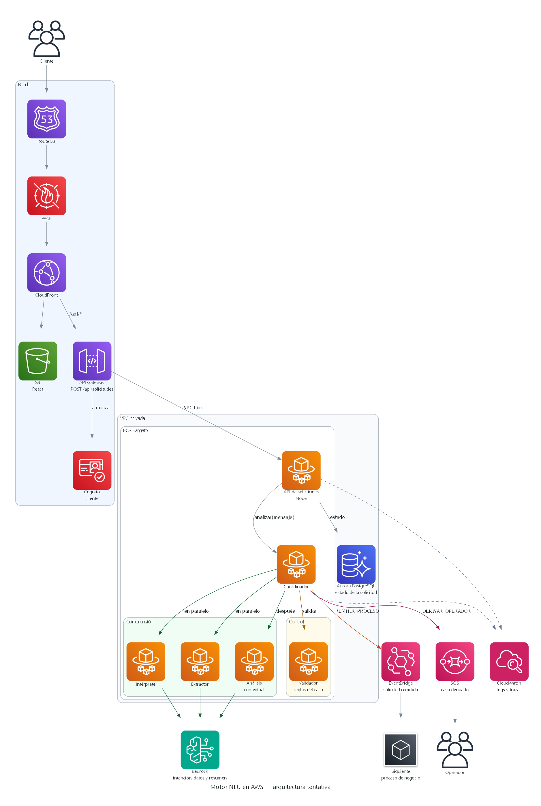

# Arquitectura AWS tentativa — Motor NLU

Esta arquitectura es el primer despliegue posible del motor en AWS. Sigue la secuencia y la interacción de identidades: una sola puerta de entrada, el coordinador como único acceso a los agentes, y tres salidas distintas. No fija el tamaño de las tareas ni la cuenta de AWS.

| Archivo | Uso |
| --- | --- |
| [`arquitectura_aws.py`](arquitectura_aws.py) | Script con la librería Diagrams |
| [`arquitectura_nlu_aws.png`](arquitectura_nlu_aws.png) | Gráfica generada al ejecutar el script |



Para volver a generar la imagen, desde esta carpeta y con Graphviz instalado:

```bash
python arquitectura_aws.py
```

## Qué representa

El cliente entra por Route 53, WAF y CloudFront. CloudFront entrega el React desde S3 y reenvía `/api/*` a API Gateway. Cognito autoriza al cliente antes de que la petición cruce a la VPC. API Gateway llega solo a la API Node, por VPC Link. Esa API es la única tarea con entrada desde el borde.

La API guarda el estado de la solicitud en Aurora y llama a `analizar(mensaje)` en el coordinador. El coordinador dispara intérprete y extractor en paralelo, después el análisis contextual y al final el validador. Intérprete, extractor y análisis llaman a Bedrock. El validador no: contrasta la salida con las reglas del caso.

## Dónde queda cada identidad

| Identidad | En AWS |
| --- | --- |
| Cliente | Persona frente a CloudFront |
| `web : InterfazWeb` | React en S3, servido por CloudFront |
| `api : ApiSolicitudes` | API Gateway más la tarea Fargate de la API Node |
| `coordinador : AgenteCoordinador` | Tarea Fargate. Solo la API la invoca |
| `interprete`, `extractor`, `analisis` | Tareas Fargate en el grupo Comprensión. Solo las llama el coordinador, y solo ellas usan Bedrock |
| `validador : AgenteValidador` | Tarea Fargate en el grupo Control. No llama al modelo ni publica eventos |
| `proceso : ProcesoNegocio` | Consumidor del evento en EventBridge |
| `operador : OperadorHumano` | Persona que toma el mensaje dejado en SQS |

Aurora, Cognito, WAF y CloudWatch no son identidades del flujo. Cubren lo que los otros diagramas dejaron fuera: estado, acceso, borde y trazas.

## Las tres salidas

| Acción | Camino | Respuesta al cliente |
| --- | --- | --- |
| `REMITIR_PROCESO` | El coordinador publica en EventBridge y espera el acuse del siguiente proceso | `200` con estado `REMITIDA` |
| `SOLICITAR_INFORMACION` | No hay otro servicio. El resultado vuelve por la misma llamada `analizar` | `200` con estado `INCOMPLETA` y las preguntas |
| `DERIVAR_OPERADOR` | El coordinador deja el caso en SQS | `200` con estado `DERIVADA` |

La aclaración del cliente es un `POST /api/solicitudes` nuevo. Recorre otra vez API, coordinador, comprensión y validador. La toma humana de la cola es posterior a esa respuesta: el acuse que ve la API es el de haber encolado el caso, no el de haberlo resuelto.

## Puntos clave

- **Una sola entrada a la VPC.** El VPC Link termina en la API. Coordinador, agentes, validador y Aurora no se publican.
- **Las flechas que faltan siguen prohibidas.** Los agentes de comprensión no se invocan entre sí. El validador no publica en EventBridge ni en SQS. Bedrock no lo llama ni la API ni el coordinador ni el validador.
- **El paralelo es de red, no solo de código.** Intérprete y extractor son dos tareas porque el coordinador las llama a la vez. El análisis espera a que ambas respondan.
- **El estado lo escribe la API.** Aurora guarda la correlación y el paso de `RECIBIDA` a `REMITIDA`, `INCOMPLETA` o `DERIVADA`. Los agentes devuelven su objeto y no abren la base.
- **La red privada incluye las salidas administradas.** Las tareas no salen a internet. Bedrock, SQS y EventBridge se consumen por endpoints de VPC. Esos endpoints no están dibujados para no tapar el recorrido de la solicitud.
- **El primer código puede ir en menos contenedores.** El repo va a empezar con React y un Node. Mientras las llamadas respeten este grafo, API, coordinador y agentes pueden convivir en un solo proceso y separarse en tareas cuando haga falta escalar el modelo o aislar al validador.
