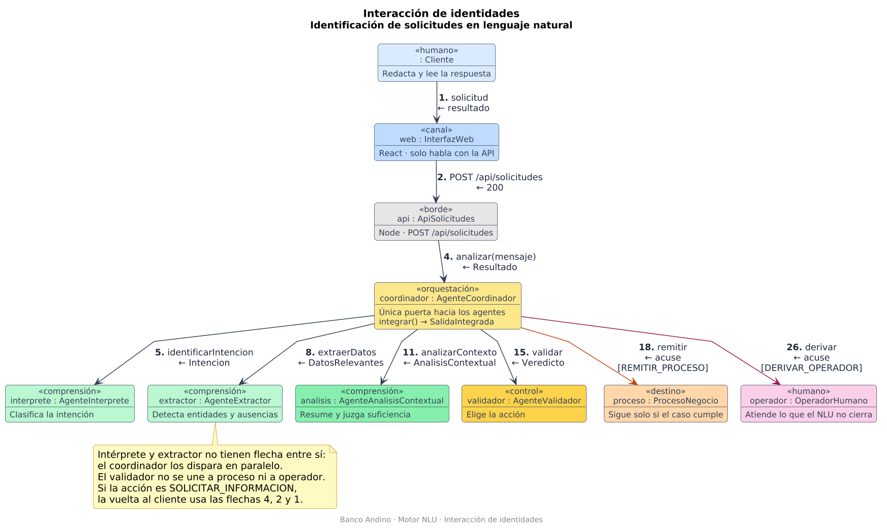

# Diagrama de interacción de identidades

Este diagrama muestra las identidades del motor NLU y los vínculos permitidos entre ellas. El de secuencia ordena los mismos mensajes en el tiempo. Este fija quién puede hablar con quién.

También complementa el diagrama de secuencia de la **Actividad 1 — Construyendo diagramas con GenAI**. La numeración de las flechas es la de ese diagrama, para cruzar ambos sin cambiar de contrato.

| Archivo | Uso |
| --- | --- |
| [`interaccion_identidades.puml`](interaccion_identidades.puml) | Fuente PlantUML |
| [`interaccion_identidades.png`](interaccion_identidades.png) | Gráfica generada a partir de esa fuente |

## Qué representa

Cada caja es una identidad, escrita como `instancia : Tipo`. El cliente y el operador son personas. El resto son piezas que el repositorio va a construir: la interfaz en React, la API en Node y los agentes.

Cada flecha es una interacción permitida. Si dos identidades no están unidas, no se hablan. Ese hueco es parte del diseño: el intérprete no llama al extractor, el análisis no llama al validador y el validador no remite el caso ni lo deriva.

La cadena de entrada es lineal. El cliente solo conoce la interfaz, la interfaz solo conoce la API y la API solo conoce al coordinador. A partir de ahí el coordinador es la única identidad que alcanza a los agentes y a los destinos.

## Identidades

| Identidad | Capa | Trabajo que se queda dentro | Habla solo con |
| --- | --- | --- | --- |
| `: Cliente` | Canal | Redactar y leer | `web` |
| `web : InterfazWeb` | Canal | Mostrar resumen, preguntas o derivación | Cliente y `api` |
| `api : ApiSolicitudes` | Borde | Correlacionar la petición y el estado | `web` y `coordinador` |
| `coordinador : AgenteCoordinador` | Orquestación | `integrar()` hasta armar la `SalidaIntegrada` | `api`, los cuatro agentes y los dos destinos |
| `interprete : AgenteInterprete` | Comprensión | Clasificar la intención | `coordinador` |
| `extractor : AgenteExtractor` | Comprensión | Detectar entidades y ausencias | `coordinador` |
| `analisis : AgenteAnalisisContextual` | Comprensión | Resumir y juzgar si los datos alcanzan | `coordinador` |
| `validador : AgenteValidador` | Control | Elegir la acción del veredicto | `coordinador` |
| `proceso : ProcesoNegocio` | Destino | Continuar el caso ya válido | `coordinador` |
| `operador : OperadorHumano` | Destino | Atender lo que el NLU no cierra | `coordinador` |

## Vínculos

| Flecha | De | Hacia | Mensaje | Vuelta |
| --- | --- | --- | --- | --- |
| 1 | Cliente | web | solicitud | resultado |
| 2 | web | api | `POST /api/solicitudes` | `200` |
| 4 | api | coordinador | `analizar(mensaje)` | `Resultado` |
| 5 | coordinador | intérprete | `identificarIntencion` | `Intencion` |
| 8 | coordinador | extractor | `extraerDatos` | `DatosRelevantes` |
| 11 | coordinador | análisis | `analizarContexto` | `AnalisisContextual` |
| 15 | coordinador | validador | `validar` | `Veredicto` |
| 18 | coordinador | proceso | `remitir` | acuse, solo si la acción es `REMITIR_PROCESO` |
| 26 | coordinador | operador | `derivar` | acuse, solo si la acción es `DERIVAR_OPERADOR` |

Los números que faltan (3, 6, 7, 9, 10 y el resto de retornos) son trabajo interno de una identidad o la respuesta de una flecha que ya está en la tabla. No crean otro vínculo.

`SOLICITAR_INFORMACION` tampoco abre una identidad nueva. El coordinador devuelve el resultado por las flechas 4, 2 y 1, y la aclaración del cliente vuelve a entrar por esa misma cadena.

## Puntos clave

- **La ausencia de flecha es una regla.** React no llama agentes. Los agentes de comprensión no se llaman entre sí. El validador no habla con el proceso de negocio ni con el operador.
- **El paralelo se ve porque no hay vínculo.** Intérprete y extractor solo se conectan al coordinador, así que pueden ejecutarse a la vez sobre el mismo mensaje.
- **El coordinador integra y enruta; el validador solo decide.** La flecha 15 devuelve el veredicto. Las flechas 18 y 26 salen del coordinador, no del validador.
- **Las personas quedan en los extremos.** El cliente abre la cadena. El operador solo aparece cuando el caso no se puede cerrar con otra pregunta.
- **Las tres acciones no son tres arquitecturas.** `REMITIR_PROCESO` usa la flecha hacia `proceso`. `DERIVAR_OPERADOR` usa la flecha hacia `operador`. `SOLICITAR_INFORMACION` reutiliza la vuelta hacia el cliente.
