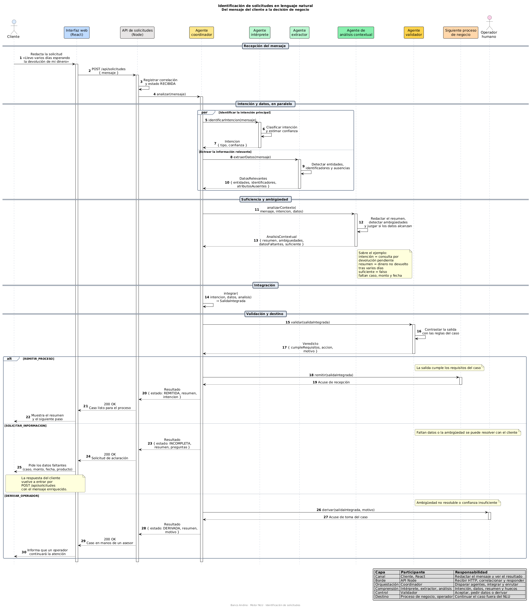

# Diagrama de secuencia — Identificación de solicitudes

Este diagrama describe el proceso que va a implementar el motor NLU de Banco Andino: recibir un mensaje del cliente, reconocer la intención, extraer lo relevante, resumir la situación y decidir si el caso puede seguir, si hay que pedir datos o si debe atenderlo una persona.

También es el diagrama de secuencia elaborado para la **Actividad 1 — Construyendo diagramas con GenAI**. Aquí queda como referencia del proyecto, no como un ejercicio aparte.

| Archivo | Uso |
| --- | --- |
| [`secuencia_identificacion_solicitudes.puml`](secuencia_identificacion_solicitudes.puml) | Fuente PlantUML |
| [`secuencia_identificacion_solicitudes.png`](secuencia_identificacion_solicitudes.png) | Gráfica generada a partir de esa fuente |

Las mismas identidades, con los vínculos permitidos y sin el orden temporal, están en [`diagrama_interaccion_identidades.md`](diagrama_interaccion_identidades.md).

## Qué representa

El flujo empieza cuando el cliente escribe en lenguaje natural y termina en una de tres salidas. Con el mensaje «Llevo varios días esperando la devolución de mi dinero», el sistema debe concluir que se trata de una devolución pendiente, resumir esa situación y señalar que no hay datos suficientes para identificar un caso concreto.

La interfaz no llama a los agentes. React envía el texto a la API en Node, y la API se lo entrega al agente coordinador. A partir de ahí el coordinador es quien dispara el resto del flujo y devuelve un único resultado.

## Participantes

| Participante | Capa | Responsabilidad |
| --- | --- | --- |
| Cliente | Canal | Redacta la solicitud y lee la respuesta. |
| Interfaz web (React) | Canal | Captura el mensaje y muestra resumen, preguntas o aviso de derivación. |
| API de solicitudes (Node) | Borde | Expone `POST /api/solicitudes`, correlaciona la petición y responde HTTP. |
| Agente coordinador | Orquestación | Dispara a los agentes, integra sus salidas y enruta según el veredicto. |
| Agente intérprete | Comprensión | Identifica la intención principal y una confianza. |
| Agente extractor | Comprensión | Obtiene entidades, identificadores y atributos que no aparecen. |
| Agente de análisis contextual | Comprensión | Redacta el resumen, detecta ambigüedades y juzga si la información alcanza. |
| Agente validador | Control | Contrasta la salida integrada con las reglas del caso y elige la acción. |
| Siguiente proceso de negocio | Destino | Recibe el caso cuando la salida ya cumple los requisitos. |
| Operador humano | Destino | Toma el caso cuando el sistema no puede cerrarlo con el cliente. |

## Recorrido

1. **Recepción.** El cliente envía el mensaje. La API lo deja en estado `RECIBIDA` y llama a `analizar(mensaje)`.
2. **Intención y datos, en paralelo.** El intérprete y el extractor trabajan a la vez sobre el texto crudo. El extractor no espera la intención: así se puede detectar después si lo extraído no coincide con lo clasificado.
3. **Suficiencia y ambigüedad.** El análisis contextual recibe el mensaje, la intención y los datos. Devuelve el resumen, las ambigüedades, los datos faltantes y si la información es suficiente.
4. **Integración.** El coordinador arma una sola `SalidaIntegrada`.
5. **Validación y destino.** El validador devuelve un `Veredicto`. El coordinador ejecuta la acción y la API responde `200` con el estado correspondiente.

Sobre el ejemplo, el análisis contextual deja esta lectura: intención de consulta por devolución pendiente, resumen de un dinero que no ha vuelto tras varios días, información insuficiente porque faltan caso, monto y fecha.

## Puntos clave

- **Una sola puerta de entrada.** React solo conoce `POST /api/solicitudes`. Los agentes quedan detrás del coordinador.
- **Paralelo solo entre intérprete y extractor.** El análisis contextual es posterior: necesita las dos salidas para resumir y para marcar huecos o contradicciones.
- **El coordinador integra; el validador decide.** Clasificar, extraer y resumir no autorizan por sí solos el paso al siguiente proceso.
- **Tres acciones, no dos.** `REMITIR_PROCESO` cuando la salida cumple. `SOLICITAR_INFORMACION` cuando falta algo que el cliente puede aclarar. `DERIVAR_OPERADOR` cuando la ambigüedad no se resuelve con otra pregunta o la confianza no alcanza.
- **Pedir datos no abre otro flujo.** La aclaración del cliente vuelve a entrar por el mismo `POST`, con el mensaje enriquecido, y recorre otra vez intérprete, extractor, análisis y validador.
- **La respuesta HTTP no distingue el destino con el código de estado.** Las tres ramas responden `200`. Lo que cambia es el cuerpo: `REMITIDA`, `INCOMPLETA` o `DERIVADA`.
- **Los contratos del diagrama son los de la implementación.** Cada flecha de retorno nombra el objeto que Node tendrá que producir.

| Objeto | Campos |
| --- | --- |
| `Intencion` | `tipo`, `confianza` |
| `DatosRelevantes` | `entidades`, `identificadores`, `atributosAusentes` |
| `AnalisisContextual` | `resumen`, `ambiguedades`, `datosFaltantes`, `suficiente` |
| `SalidaIntegrada` | `intencion`, `datos`, `analisis` |
| `Veredicto` | `cumpleRequisitos`, `accion`, `motivo` |

`accion` solo admite `REMITIR_PROCESO`, `SOLICITAR_INFORMACION` o `DERIVAR_OPERADOR`.

## Qué deja fuera a propósito

El diagrama fija el recorrido de una solicitud ya recibida. No modela persistencia, autenticación ni el detalle interno del siguiente proceso de negocio: ese proceso solo acusa recibo. Esas piezas se agregan cuando el backend las necesite, sin cambiar el orden de los agentes ni las tres salidas.
