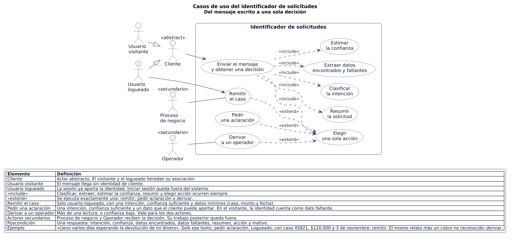
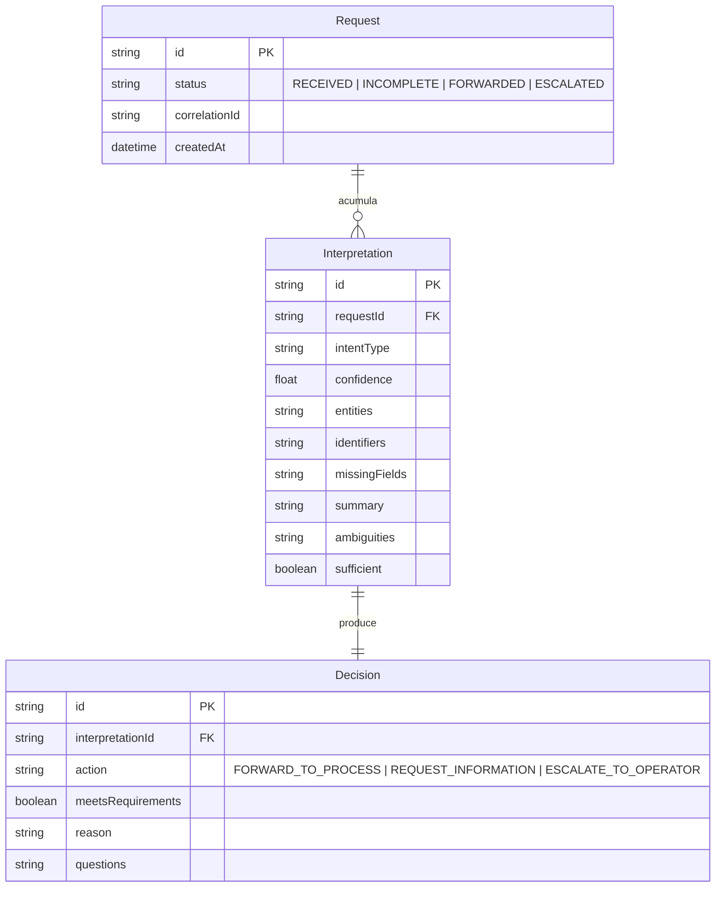
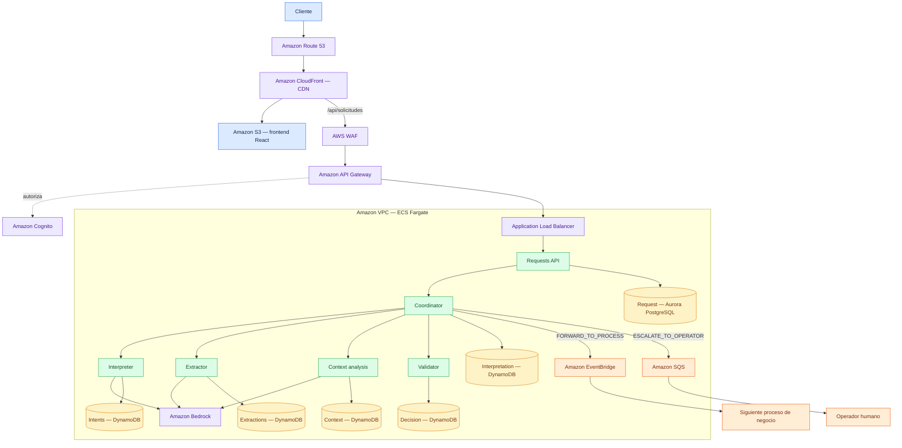

# Actividad 2: Planeando un software con GenAI

## Prompt #1

> Eres un experto en producto, con experiencia en Identificación de solicitudes en lenguaje natural (motor NLU). ¿Qué funcionalidades básicas tiene un motor NLU? Descríbemelas en un listado, ordenado de mayor a menor prioridad

## Respuesa

En el motor de Banco Andino, la prioridad la marca lo que permite actuar sobre la solicitud sin equivocar el caso. Primero hay que entender qué pide el cliente y con qué datos; después, si esa lectura es segura y completa; al final, qué hacer con ella.

1. **Clasificar la intención principal.** Reconocer de qué se trata el mensaje (por ejemplo, una devolución pendiente) y devolver un tipo de solicitud. Sin esa etiqueta, el resto del flujo no tiene destino.

2. **Extraer la información relevante.** Obtener entidades, identificadores y atributos del texto (caso, monto, fecha, producto) y señalar cuáles no aparecen. La intención sola no alcanza para abrir o continuar un trámite.

3. **Estimar la confianza.** Acompañar la intención con un grado de certeza. En banca, una lectura poco segura no debe pasar al siguiente proceso.

4. **Juzgar si la información alcanza y detectar ambigüedades.** Decidir si los datos bastan para un caso concreto y marcar lecturas dudosas o contradictorias. Evita remitir un caso incompleto o mal interpretado.

5. **Resumir el problema.** Redactar en pocas líneas qué ocurre, para que el proceso siguiente o un operador trabajen sobre esa lectura y no sobre el mensaje crudo.

6. **Decidir el destino.** Con la salida ya integrada, elegir una sola acción: remitir al proceso de negocio, pedir una aclaración al cliente o derivar a un operador, y dejar el motivo de esa decisión.

7. **Formular la aclaración.** Cuando faltan datos que el cliente puede aportar, devolver preguntas concretas (caso, monto, fecha) en lugar de un rechazo genérico.

8. **Conservar el contexto entre mensajes.** Tratar la respuesta del cliente como continuación de la misma solicitud, no como un texto nuevo, y volver a interpretar, extraer y validar sobre el mensaje enriquecido.

9. **Dejar trazabilidad de la lectura.** Registrar intención, datos, resumen, confianza y motivo del veredicto. Sirve para auditar el caso y corregir el motor; no bloquea la primera atención.

## Prompt #2

> ¿Qué beneficios obtiene el cliente de un Identificador de solicitudes en lenguaje natural (motor NLU) para considerar su uso?

## Respuesta

El cliente lo usa porque puede contar el problema con sus palabras y recibir una respuesta útil en el mismo momento: el trámite sigue, le piden solo lo que falta o una persona toma el caso ya entendido.

1. **Explica el caso como lo vive.** Escribe «llevo varios días esperando la devolución de mi dinero» y el banco reconoce que se trata de una devolución pendiente. No tiene que saber el nombre interno del trámite ni recorrer un menú hasta encontrarlo.

2. **Llega al proceso correcto en el primer mensaje.** Si la solicitud está clara y trae los datos necesarios, el caso pasa al área que lo resuelve. El cliente evita repetir la historia en otro canal.

3. **Aporta menos datos de los que ya dijo.** El motor toma del texto lo que sirve (producto, monto, fecha, número de caso). El cliente no vuelve a llenar un formulario con información que ya escribió.

4. **Recibe preguntas concretas cuando algo falta.** Si no alcanza para identificar el caso, la respuesta pide exactamente eso: número de caso, monto o fecha. El cliente sabe qué completar y puede responder en el mismo hilo.

5. **No queda atrapado cuando el mensaje es confuso.** Si hay más de una lectura posible o la certeza es baja, una persona recibe el caso con el resumen ya armado. El cliente no empieza de cero ni espera a que alguien vuelva a interpretar el mensaje.

6. **Sigue la misma solicitud al aclarar.** La respuesta del cliente se suma al mensaje original. No abre un trámite nuevo ni pierde lo que ya había contado.

7. **Ve en qué quedó su solicitud.** La respuesta le dice si fue remitida, si está incompleta o si pasó a un operador. Sabe qué esperar a continuación.

## Prompt #3

> ¿Cómo es el customer journey normal de un cliente que usa un Identificador de solicitudes en lenguaje natural (motor NLU)? Descríbeme paso a paso todas las interacciones

## Respuesta

El recorrido normal es el de una solicitud que el primer mensaje no alcanza a cerrar un flujo de negocio completo, sirve como habilitador. El cliente cuenta el caso, ve qué entendió el banco, completa solo lo que falta y recibe el destino final en el mismo hilo. El ejemplo es: «Llevo varios días esperando la devolución de mi dinero».

1. **Entra al canal.** El cliente abre la web del banco, inicia sesión y llega a la pantalla para escribir una solicitud. Ve un campo de texto libre y el botón para enviarla.

2. **Redacta con sus palabras.** Escribe el mensaje tal como lo vive. No elige un tipo de trámite ni llena un formulario previo.

3. **Envía la solicitud.** La interfaz manda el texto. El cliente espera en la misma pantalla mientras el banco lee el mensaje.

4. **Ve qué se entendió.** La respuesta muestra el resumen: lleva varios días esperando un dinero que no ha vuelto, y la lectura es una consulta por devolución pendiente. Así comprueba si el banco interpretó bien el caso.

5. **Recibe las preguntas que faltan.** El caso queda incompleto. La pantalla pide número de caso, monto y fecha. No le pide repetir el relato.

6. **Responde en el mismo hilo.** Escribe esos datos y los envía. El banco los suma al mensaje original y vuelve a leer la solicitud completa.

7. **Recibe el cierre de la identificación.** Si con esos datos el caso queda claro, la pantalla muestra el resumen actualizado y le indica que la solicitud fue remitida al proceso que la resuelve. Ahí termina su interacción con el identificador.

En ese mismo punto de respuesta, el cliente puede encontrar otra salida:

- **Sigue incompleta.** Si aún falta algo que él puede aclarar, la pantalla hace otra pregunta concreta y el paso 6 se repite.
- **Pasa a una persona.** Si el mensaje admite más de una lectura o la certeza es baja, la pantalla le avisa que un operador continúa la atención. El cliente no vuelve a contar el caso: el operador ya tiene el resumen y el motivo de la derivación.

## Prompt #4 (Planeación desde los casos de uso)

> Eres un analista de software experto. Estoy construyendo un MVP de un identificador de solicitudes en lenguaje natural para un banco, que solamente haga esto: recibir un mensaje escrito por el cliente y devolver una sola decisión sobre ese mensaje.

> La decisión tiene tres salidas posibles:
> - remitir el caso, si la intención es clara y los datos alcanzan;
> - pedir una aclaración, si falta algo que el cliente puede responder;
> - derivar a un operador, si el mensaje es ambiguo o la confianza es baja.

> Cada respuesta debe incluir la intención, la confianza, los datos encontrados, los datos que faltan, un resumen breve y la acción elegida con su motivo.

> No incluyas inicio de sesión, pantallas, bases de datos, ni la atención posterior del operador o del proceso de negocio. El MVP termina cuando el mensaje ya tiene una decisión.

> Enumera y describe brevemente los casos de uso más importantes a implementar para lograr esa funcionalidad básica. Usa como ejemplo el mensaje «Llevo varios días esperando la devolución de mi dinero» y cubre las tres salidas.

## Respuesta

El MVP se cubre con seis casos de uso. El primero es la única entrada: un mensaje entra y sale una decisión. Los otros cinco arman las piezas de esa respuesta. El mensaje de ejemplo muestra las tres salidas según los datos que traiga y si admite una sola lectura.

**1. Recibir el mensaje y devolver una decisión.** El cliente envía un texto. El motor responde una sola vez con la intención, la confianza, los datos encontrados, los datos que faltan, un resumen breve, la acción y el motivo. Con esa respuesta el MVP termina.

**2. Clasificar la intención.** En «Llevo varios días esperando la devolución de mi dinero» la intención es una devolución pendiente. Si el texto admite otra lectura igual de plausible, la clasificación conserva esa duda para el veredicto.

**3. Extraer los datos encontrados y los que faltan.** Del mismo mensaje se obtienen la espera de varios días, el objeto (dinero) y el trámite (devolución). No aparecen el número de caso, el monto ni la fecha, que son los datos que identifican un caso concreto, y quedan marcados como faltantes.

**4. Estimar la confianza.** Cada intención lleva un grado de certeza. Un texto directo, con una sola lectura, mantiene la confianza alta. Dos lecturas en pugna o un texto vago la bajan. Ese valor entra en la decisión.

**5. Resumir la solicitud.** El motor redacta en una o dos frases lo que entendió: el cliente espera hace varios días la devolución de un dinero y no identifica el movimiento. Ese resumen viaja en la respuesta para que el destino trabaje sobre la lectura y no sobre el texto crudo.

**6. Elegir una sola acción.** Se remite el caso si hay una intención y los datos mínimos están. Se pide una aclaración si la intención se sostiene y falta algo que el cliente puede decir. Se deriva a un operador si hay más de una lectura o la confianza no alcanza. El mismo ejemplo cae en cada salida así:

- **Remitir.** «Llevo varios días esperando la devolución de mi dinero del caso 45821, por $120.000, de la compra del 3 de noviembre.» Intención: devolución pendiente. Confianza alta. Datos: caso, monto, fecha y varios días de espera. Faltantes: ninguno de los exigidos. Resumen: la devolución del caso 45821, por $120.000, sigue pendiente. Acción: remitir. Motivo: intención única y datos mínimos completos.
- **Pedir aclaración.** El mensaje tal como está. Intención: devolución pendiente. Confianza suficiente para esa etiqueta. Datos: varios días de espera, dinero y devolución. Faltantes: caso, monto y fecha. Resumen: el cliente espera una devolución y no identifica el movimiento. Acción: pedir aclaración. Motivo: la intención es clara y el cliente puede aportar el caso, el monto o la fecha. La respuesta nombra esas tres preguntas.
- **Derivar a un operador.** «Llevo varios días esperando la devolución de mi dinero, o quizá fue un cobro de la tarjeta que no reconozco.» Intención: compiten una devolución pendiente y una transacción no reconocida. Confianza baja para quedarse con una sola. Datos: espera y dinero; la tarjeta solo aparece en la segunda lectura. Resumen: el texto admite una devolución atrasada o un cobro no reconocido. Acción: derivar. Motivo: hay dos lecturas posibles y la confianza no alcanza para elegir una.

## Prompt #5 

Representa estos casos de uso en el tipo de diagrama más adecuado usando el formato plantUML. Diferencia entre usuarios visitantes y usuarios logueados. Acorde a la sintaxis y buenas prácticas UML, define y describe lo que sea necesario.

## Respuesta

El diagrama de casos de uso está en [`casos_de_uso.puml`](casos_de_uso.puml). La gráfica generada a partir de esa fuente:

## Prompt #6

> Eres un arquitecto de software experto. Cuales son las 3 entidades de modelo de datos esenciales en un sistema de identificador de solicitudes en lenguaje natural? Dame algunos campos esenciales de cada una y cómo se relacionan. Genera un diagrama Mermaid del sistema

## Respuesta

Las tres entidades que sostienen el identificador son **Request**, **Interpretation** y **Decision**. La solicitud es el caso que el cliente va construyendo; la interpretación es lo que el motor entendió en un paso; la decisión es la única acción que sale de esa interpretación. 

## Request

Es la raíz del modelo. Vive mientras el cliente aclara el caso y concentra el estado visible del trámite.

| Campo | Rol |
| --- | --- |
| `id` | Identidad del caso |
| `status` | `RECEIVED`, `INCOMPLETE`, `FORWARDED` o `ESCALATED` |
| `correlationId` | Une el `POST /api/solicitudes` con la respuesta |
| `createdAt` | Orden y auditoría del hilo |

El texto no vive aquí como un solo string definitivo. Cada envío del cliente es una vuelta sobre la misma solicitud.

## Interpretation

Es el resultado de un paso de comprensión: intención, datos y juicio de suficiencia sobre el mensaje ya enriquecido. No decide el destino.

| Campo | Rol |
| --- | --- |
| `intentType` | Etiqueta principal, por ejemplo devolución pendiente |
| `confidence` | Certeza de esa etiqueta |
| `entities` | Lo que sí aparece: espera, dinero, devolución |
| `identifiers` | Caso, monto, fecha, producto cuando vienen en el texto |
| `missingFields` | Lo que el caso exige y no está |
| `summary` | Una o dos frases de lo entendido |
| `ambiguities` | Lecturas en pugna |
| `sufficient` | Si los datos alcanzan para un caso concreto |

Intención, entidades y resumen son valores de esta interpretación. No tienen identidad propia: si el cliente aclara, se produce otra interpretación, no se reescribe la anterior.

## Decision

Es el veredicto de una interpretación. El motor responde una sola vez con ella.

| Campo | Rol |
| --- | --- |
| `action` | `FORWARD_TO_PROCESS`, `REQUEST_INFORMATION` o `ESCALATE_TO_OPERATOR` |
| `meetsRequirements` | Si la interpretación pasa las reglas del caso |
| `reason` | Por qué se eligió esa acción |
| `questions` | Solo cuando la acción pide aclaración: caso, monto, fecha |

## Cómo se relacionan

### Diagrama Mermaid

- Una **Request** tiene varias **Interpretation**: el primer mensaje y cada aclaración vuelven a entrar por el mismo `POST` y generan una interpretación nueva.
- Cada **Interpretation** tiene una sola **Decision**. Clasificar y extraer no autorizan el paso; el veredicto sí.
- El `status` de la **Request** es la proyección de la última decisión: remitir deja `FORWARDED`, pedir datos deja `INCOMPLETE`, derivar deja `ESCALATED`.

Con el ejemplo «Llevo varios días esperando la devolución de mi dinero», la solicitud nace en `RECEIVED`. La interpretación marca intención de devolución pendiente, confianza suficiente, faltantes de caso, monto y fecha, y `sufficient = false`. La decisión pide aclaración y nombra esas tres preguntas. Si el cliente responde en el mismo hilo, nace otra interpretación sobre el mismo caso; no se abre otra solicitud.

## Prompt #7

> A microservices architecture for an NLU Engine system like expedia Each MS has its own database Also has a frontend that communicates through API Cloud provider is AWS, use proper services Include load balancing and CDN

## Respuesta

Este es el motor NLU de Banco Andino: el frontend solo habla con la API, cada microservicio tiene su propia base y el borde usa los servicios de AWS que ya fija la arquitectura del proyecto.

El cliente entra por Route 53 y CloudFront. CloudFront entrega el React desde S3 y reenvía `/api/*` a API Gateway. Cognito autoriza la llamada; no es un salto hacia el balanceador. El Application Load Balancer reparte solo hacia Requests API, la única tarea publicada dentro de la VPC. A partir de ahí el coordinador es el único que llama a los demás servicios.

| Microservicio | Base propia | Qué guarda |
| --- | --- | --- |
| Requests API | Aurora PostgreSQL | `Request` |
| Coordinator | DynamoDB | `Interpretation` ya integrada |
| Interpreter | DynamoDB | `intentType` y `confidence` |
| Extractor | DynamoDB | `entities` e `identifiers` |
| Context analysis | DynamoDB | `summary`, `ambiguities`, `missingFields`, `sufficient` |
| Validator | DynamoDB | `Decision` |

Intérprete, extractor y análisis contextual llaman a Bedrock y no se llaman entre sí. El validador no usa el modelo. `REQUEST_INFORMATION` vuelve por la misma llamada. `FORWARD_TO_PROCESS` sale por EventBridge hacia el proceso de negocio. `ESCALATE_TO_OPERATOR` deja el caso en SQS para el operador. La API proyecta esa acción en `Request.status`.

